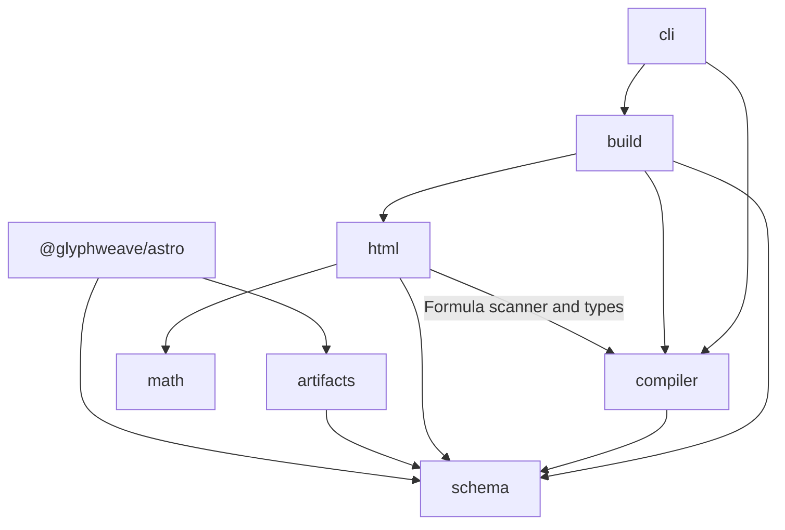

# Architecture

Glyphweave is a build-time publishing engine for trusted Typst authors. It produces
sanitized HTML, a table of contents, manifests, a content index, static resources
and optional PDFs. A consuming site reads these artifacts; it does not compile
Typst when a visitor requests a page.

## Repository and package boundaries

The implementation consists of **two TypeScript packages and one Rust executable**.
The directories inside the main package are internal modules, not independently
versioned packages.

```text
packages/
  glyphweave/             glyphweave: publishing API and CLI
    src/
      schema/             Input and artifact schemas
      compiler/           Compiler processes and diagnostics
      html/               HTML adaptation and resource handling
      math/               Native layout rendering and browser copy support
      build/              Build orchestration, caching and commit
      artifacts/          Artifact readers and static-resource export
      cli/                Command-line interface
    prelude/              Typst HTML/PDF wrappers
    styles/               Mathematical layout styles
  astro/                  @glyphweave/astro: Astro content loader
crates/typst-html/         glyphweave-typst-html: native compiler bridge
examples/minimal/         Minimal Typst publishing example
examples/astro-blog/      Website integration example
scripts/                  Native build, package distribution and cleanup
tests/                   Unit, integration, browser and benchmark programs
docs/                    Usage, architecture and decision records
.github/                  CI and repository maintenance
```

`node_modules/`, `dist/`, `.glyphweave/`, package compilation outputs and Cargo's
`target/` contain installed dependencies or generated files. They are not source
modules. Root configuration coordinates the workspace; runtime dependencies belong
to the package that uses them.

## Main package modules and public API

The public entrypoints are declared in
[`packages/glyphweave/package.json`](../packages/glyphweave/package.json).

| Source module | Public entrypoint       | Responsibility                                                                                              |
| ------------- | ----------------------- | ----------------------------------------------------------------------------------------------------------- |
| `schema/`     | `glyphweave/schema`     | Validate configuration, metadata, manifests and indexes; infer their TypeScript types.                      |
| `compiler/`   | `glyphweave/compiler`   | Run Typst CLI or the native bridge; stage wrappers; collect diagnostics and compiler/font/package identity. |
| `html/`       | `glyphweave/html`       | Sanitize and normalize HTML, headings, math and code; rewrite article resources and produce a TOC.          |
| `math/`       | `glyphweave/math`       | Validate native layout data and render HTML/CSS plus subset font resources.                                 |
| `build/`      | `glyphweave`            | Discover inputs, orchestrate document compilation, validate cache reuse and commit a complete generation.   |
| `artifacts/`  | `glyphweave/artifacts`  | Read validated index snapshots and post content; select published posts and export current resources.       |
| `cli/`        | `glyphweave` executable | Expose `build`, `clean`, `inspect` and `doctor` commands using the core APIs.                               |

`glyphweave/browser` exposes optional formula selection/copy enhancement from
`math/browser.ts`; `glyphweave/styles/*` exposes styles. Formula rendering and
accessible semantics do not require the browser enhancement.

Internal dependency direction is:



The HTML adapter accepts a minimal article context and does not import `build/`.
The artifact readers do not import build orchestration. `BuildDependencies` allows
tests and hosts to supply compiler operations; a custom compiler must also supply
`cacheIdentity` to enable caching. The Astro package consumes public entrypoints
and has no build-time dependency on InkStack or a personal blog repository.

## Build flow, publication and commit

[`buildDocuments`](../packages/glyphweave/src/build/build.ts) builds the documents
returned by its caller. It does not choose publication states.
[`buildAll`](../packages/glyphweave/src/build/build-all.ts), used by the CLI, adds the
standalone publishing policy: discover articles and select published, non-private
posts. Hosts can supply their own document selection for previews.

```text
post.yaml + index.typ + includes/assets
  -> validate output ownership and acquire the output lock
  -> load documents and validate slugs and compiler environment
  -> create generations/<id>/
  -> for each article:
       verify and copy a cache hit into the new generation, or
       compile HTML -> adapt HTML/math/resources -> optional PDF -> manifest
  -> recheck article inputs, compiler environment and implementation identity
  -> write generation cache and schema-validated content index
  -> atomically replace the authoritative content-index.json
  -> read one index snapshot -> load content and export selected resources
```

The default store is `.glyphweave/`. Each article's files live below
`generations/<id>/generated/posts/<slug>/`. `build-post.ts` handles one article;
`cache.ts`, `fingerprint.ts`, `manifest.ts`, `content-index.ts` and `output.ts`
separate reuse, identity, artifact descriptions, indexing and output ownership.
`compiler/environment.ts` fingerprints Typst, fonts and packages. HTML and PDF
wrappers share staging and cleanup code in `compiler/compiler.ts`.

A failed build preserves the previous authoritative index and removes its
uncommitted generation. Successful older generations remain until explicit clean,
so a reader holding an earlier snapshot can finish. Consumers must follow paths
from one index snapshot rather than enumerate generations or guess output paths.
Writers are serialized with an output lock. Clean validates output ownership and
acquires that lock; callers must also stop readers before deleting the store.
See [incremental caching](cache.md) for invalidation and reproducibility details.

`publishedPosts(index, true)` selects published/public posts for listings and
search. Published/unlisted posts may have direct routes but stay out of those
lists. Private, draft and archived posts are excluded from production asset export.
The consuming site owns route and search generation; the Astro loader does not
independently filter the supplied index. A PDF failure configured as `warn` keeps
the HTML, omits that PDF and records a diagnostic; that result is not cached for
reuse. `exportGlyphweaveAssets` stages only current, publishable manifest resources
and replaces an owned destination under `public/` with rollback on failure.

## Native mathematical layout and PDF

The default `math.strategy` is **`html-frame`**; `mathml` and `svg-frame` are explicit
alternatives. [`crates/typst-html/src`](../crates/typst-html/src) contains:

- `main.rs`: executable arguments, compilation and HTML/layout output.
- `frame.rs`: extraction of Typst frames, glyphs, geometry and font data.
- `source.rs`: capture of equation source representations.
- `world.rs`: controlled file access and deterministic compilation time.

The native executable embeds the Typst Rust compiler and writes raw HTML plus a
`.layout.json` sidecar. `html/native-math.ts` validates that sidecar through
`math/`, prepares fonts/styles and inserts the renderer-owned output after author
HTML sanitization. Visible `html-frame` equations use Typst geometry rendered as
HTML/CSS and glyph fonts; MathML provides accessible semantics. The ordinary Typst
CLI compiles PDFs independently and also serves the alternative HTML strategies.

Developers explicitly run `pnpm build:native` to build and copy the executable into
`packages/glyphweave/native/<platform>-<arch>/`. Normal document builds resolve an
explicit binary path, PATH executable or bundled native binary; they do not invoke
Cargo automatically. `pnpm pack:packages` compiles the TypeScript packages and
packages the prepared native executable for the current OS/architecture. A matching
prebuilt archive lets consumers use the default renderer without a Rust toolchain.
See [native math](native-math-renderer.md) and [PDF typography](pdf-typography.md).

## Astro and consuming sites

[`@glyphweave/astro`](../packages/astro/src/index.ts) provides `glyphweaveLoader`.
It reads one index snapshot, validates artifact paths, loads HTML and headings,
parses collection data and computes entry digests. An optional `transform` maps
these values to the host site's collection shape.

In development the loader watches the index, serializes/coalesces reloads through
`task-queue.ts`, and prepares all entries before replacing the content store. A
failed reload retains the previous loaded snapshot. The host must run the compiler
and export static resources separately; loading an index does not compile articles
or copy their assets. Pages, navigation, search and deployment belong to the host.
`examples/astro-blog/` demonstrates that integration without depending on InkStack.

## Trust boundaries and verification

Authors and executable TypeScript configuration are trusted. The adapter constrains
HTML/MathML/static SVG, URLs, resource paths and numeric styles. Code highlighting
and native formula insertion are subsequent trusted transforms. Raw HTML, layout
sidecars and logs are diagnostic/intermediate files, not deployment inputs.
Lexical formula counts are hints; strict capture rejects compiler-confirmed loss.
See [security](security.md) and the [build/publication decision](decisions/0001-build-and-publication-contract.md).

`tests/unit/` covers schemas, orchestration and failure paths. `tests/integration/`
exercises real compilers, PDFs, native layout and standalone packages;
`tests/browser/` covers the example site, and `tests/fixtures/` supplies documents.
Benchmarks live in `tests/benchmarks/`. CI runs the standard `check` job for PRs and
main pushes; the additional native/package/browser integration job runs on manual
workflow dispatch. See [acceptance](acceptance.md) for verification commands.
