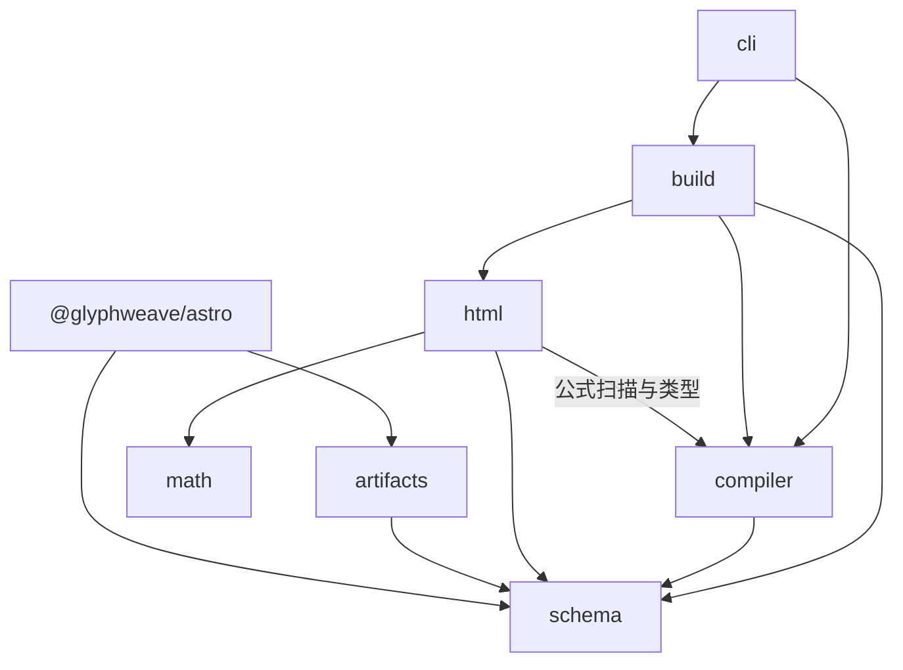

# 架构

Glyphweave 面向受信的 Typst 作者，在构建时生成经过清洗的 HTML 正文、目录、manifest、内容索引、静态资源和可选 PDF。站点消费这些产物，访客请求页面时不调用 Typst 编译器。

## 仓库与包边界

当前实现由**两个 TypeScript 包和一个 Rust 可执行程序**组成。主包内部按职责划分模块，这些模块不单独版本化或发布。

```text
packages/
  glyphweave/             glyphweave：发布 API 与 CLI
    src/
      schema/             输入与产物的数据结构校验
      compiler/           编译进程、诊断与环境检查
      html/               HTML 转换与资源处理
      math/               原生公式布局渲染与浏览器复制增强
      build/              构建编排、缓存与提交
      artifacts/          产物读取与静态资源导出
      cli/                命令行接口
    prelude/              Typst HTML/PDF 包装模板
    styles/               数学排版样式
  astro/                  @glyphweave/astro：Astro 内容加载器
crates/typst-html/         glyphweave-typst-html：原生编译桥
examples/minimal/         最小 Typst 发布示例
examples/astro-blog/      网站接入示例
scripts/                  原生编译、分发打包与清理
tests/                   单元、集成、浏览器测试与基准程序
docs/                    使用说明、架构与决策记录
.github/                  CI 与仓库维护
```

`node_modules/`、`dist/`、`.glyphweave/`、各包编译输出及 Cargo 的 `target/` 存放安装的依赖或生成文件，不属于源码模块。根配置协调工作区，运行依赖由使用它们的包声明。

## 主包模块与公开接口

公开入口以 [`packages/glyphweave/package.json`](../../packages/glyphweave/package.json) 的声明为准。

| 源码模块     | 公开入口                | 职责                                                                              |
| ------------ | ----------------------- | --------------------------------------------------------------------------------- |
| `schema/`    | `glyphweave/schema`     | 校验配置、元数据、manifest 和索引，并推导 TypeScript 类型。                       |
| `compiler/`  | `glyphweave/compiler`   | 调用 Typst CLI 或原生编译桥，暂存包装模板，收集诊断与编译器、字体、包的身份信息。 |
| `html/`      | `glyphweave/html`       | 清洗和归一化 HTML、标题、公式与代码，重写文章资源并生成目录。                     |
| `math/`      | `glyphweave/math`       | 校验原生布局数据，生成 HTML/CSS 和字体子集资源。                                  |
| `build/`     | `glyphweave`            | 发现输入、编排文档编译、校验缓存复用并提交完整构建结果。                          |
| `artifacts/` | `glyphweave/artifacts`  | 读取经过校验的索引快照与正文，筛选已发布文章并导出当前资源。                      |
| `cli/`       | `glyphweave` 可执行命令 | 通过核心 API 提供 `build`、`clean`、`inspect` 和 `doctor`。                       |

`glyphweave/browser` 从 `math/browser.ts` 导出可选的公式选择与复制增强；`glyphweave/styles/*` 导出样式。公式显示与无障碍语义不依赖浏览器增强脚本。

内部依赖方向如下：



HTML 适配器接收最小文章上下文，不导入 `build/`；产物读取器也不依赖构建编排。`BuildDependencies` 允许测试与宿主注入编译操作，自定义编译器必须额外提供 `cacheIdentity` 才会启用缓存。Astro 包通过公开入口读取产物，不依赖 InkStack 或个人博客仓库。

## 构建流程、发布策略与提交

[`buildDocuments`](../../packages/glyphweave/src/build/build.ts) 编译调用方提供的文档，不决定文章的发布状态。[`buildAll`](../../packages/glyphweave/src/build/build-all.ts) 为 CLI 增加独立发布策略：扫描文章，选择已发布且非 private 的内容。宿主可以为预览提供自己的文档选择逻辑。

```text
post.yaml + index.typ + includes/assets
  → 校验输出目录归属并取得输出锁
  → 加载文档，校验 slug 和编译环境
  → 创建 generations/<id>/
  → 对每篇文章：
       校验缓存命中并复制到新构建目录，或
       编译 HTML → 处理正文、公式与资源 → 可选 PDF → manifest
  → 再次核对文章输入、编译环境和实现指纹
  → 写入本次缓存与经过 schema 校验的内容索引
  → 原子替换权威 content-index.json
  → 固定一个索引快照，读取内容并导出选定资源
```

默认产物库位于 `.glyphweave/`，每篇文章存放在 `generations/<id>/generated/posts/<slug>/` 下。`build-post.ts` 处理单篇文章；`cache.ts`、`fingerprint.ts`、`manifest.ts`、`content-index.ts` 和 `output.ts` 分别处理缓存复用、身份指纹、产物描述、索引和输出归属。`compiler/environment.ts` 记录 Typst、字体与包的指纹，HTML/PDF 包装器共用 `compiler/compiler.ts` 的暂存与清理逻辑。

构建失败会保留上一份权威索引，并删除本次未提交的构建目录；成功的历史构建保留到显式清理，使持有旧快照的读取操作可以完成。消费者必须沿同一个索引快照中的路径读取，不能扫描历史目录或猜测输出路径。输出锁串行化写入。清理会检查目录归属并取得输出锁，调用方还须先停止读取操作。缓存失效与可复现性规则见[增量缓存](cache.md)。

`publishedPosts(index, true)` 为列表和搜索选择 published/public 文章。published/unlisted 可以拥有直接路由，但不进入这些列表；private、draft、archived 不进入生产资源导出。路由和搜索由消费产物的网站生成，Astro 加载器本身不会再次筛选传入索引的发布状态。PDF 失败策略为 `warn` 时保留 HTML、移除该 PDF 并记录诊断，这次结果不会作为缓存复用。`exportGlyphweaveAssets` 只暂存当前可发布 manifest 引用的资源，再替换 `public/` 下有归属标记的目标目录，失败时回滚。

## 原生公式布局与 PDF

`math.strategy` 默认是 **`html-frame`**，`mathml` 与 `svg-frame` 是显式可选策略。[`crates/typst-html/src`](../../crates/typst-html/src) 包含：

- `main.rs`：解析命令参数，执行编译，写出 HTML 与布局数据。
- `frame.rs`：提取 Typst frame、字形、几何信息和字体数据。
- `source.rs`：捕获公式源码表示。
- `world.rs`：约束文件访问并固定编译时间。

原生程序嵌入 Typst 的 Rust 编译器，输出原始 HTML 与 `.layout.json` 辅助文件。`html/native-math.ts` 通过 `math/` 校验布局数据、准备字体与样式，并在作者 HTML 清洗后插入渲染器生成的内容。`html-frame` 的可见公式通过 HTML/CSS 和字形字体呈现 Typst 几何布局，MathML 提供无障碍语义。普通 Typst CLI 独立编译 PDF，也承担其余 HTML 策略的编译。

开发者需显式运行 `pnpm build:native`，把编译后的可执行程序放入 `packages/glyphweave/native/<platform>-<arch>/`。普通文档构建会查找显式配置的路径、PATH 或包内二进制，不会自动调用 Cargo。`pnpm pack:packages` 编译 TypeScript 包，并为当前操作系统和架构打包已准备好的原生程序。消费方取得匹配平台的预编译归档后，无需 Rust 工具链即可使用默认渲染器。详见[原生数学渲染](../native-math-renderer.md)与 [PDF 排版](../pdf-typography.md)。

## Astro 与消费产物的网站

[`@glyphweave/astro`](../../packages/astro/src/index.ts) 提供 `glyphweaveLoader`：读取一次索引快照、校验产物路径、加载正文和标题、解析集合数据并计算条目摘要。可选 `transform` 将这些内容映射到宿主网站的集合结构。

开发时，加载器监听索引变化，通过 `task-queue.ts` 合并连续更新并串行重载，在所有条目准备成功后才替换内容存储；失败时保留上一次加载的快照。宿主需另行执行编译与静态资源导出，加载索引本身不会编译文章或复制资源。页面、导航、搜索和部署属于宿主职责，`examples/astro-blog/` 展示了无需 InkStack 的接入方式。

## 信任边界与验证

作者和可执行的 TypeScript 配置属于受信输入。适配器约束 HTML/MathML/静态 SVG、URL、资源路径与数值样式；代码高亮和原生公式插入是后续受信转换。原始 HTML、布局辅助文件和日志是诊断或中间产物，不作为部署输入。词法公式数量仅提供提示，严格捕获模式依据编译器确认的内容丢失失败。参见[安全模型](security.md)和[构建与发布决策](../decisions/0001-build-and-publication-contract.md)。

`tests/unit/` 覆盖 schema、编排和失败路径；`tests/integration/` 验证真实编译器、PDF、原生布局及独立安装包；`tests/browser/` 验证示例站；`tests/fixtures/` 存放测试文档；基准程序位于 `tests/benchmarks/`。CI 在 PR 和 main 推送时运行常规 `check`，额外的原生编译、包和浏览器集成任务由手动 workflow dispatch 触发。验证命令见[验收说明](../acceptance.md)。
